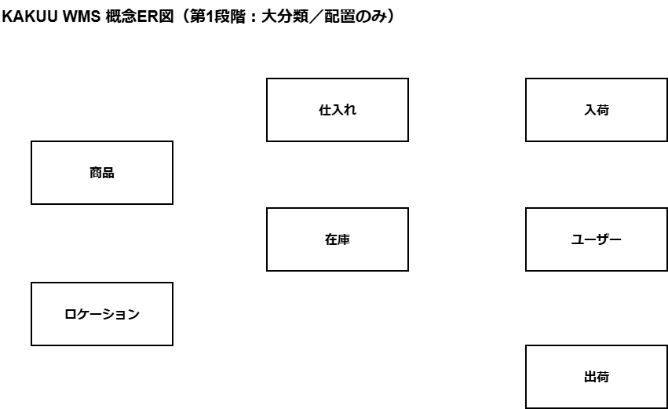
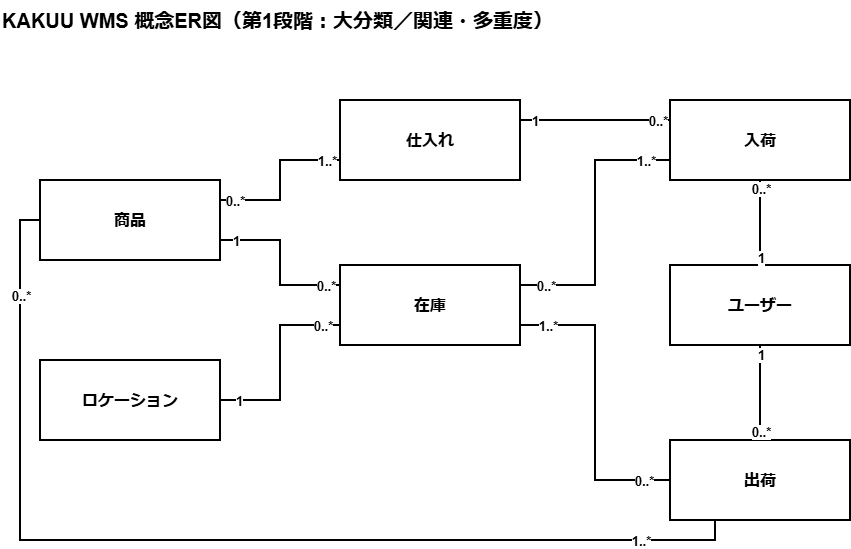
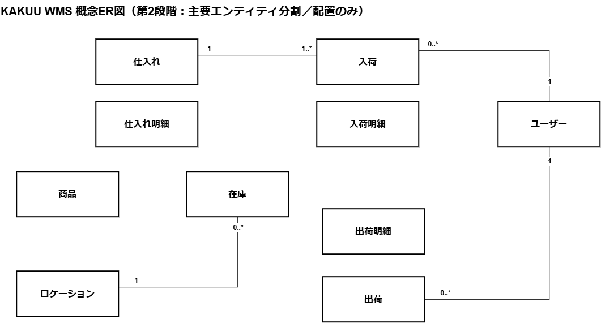
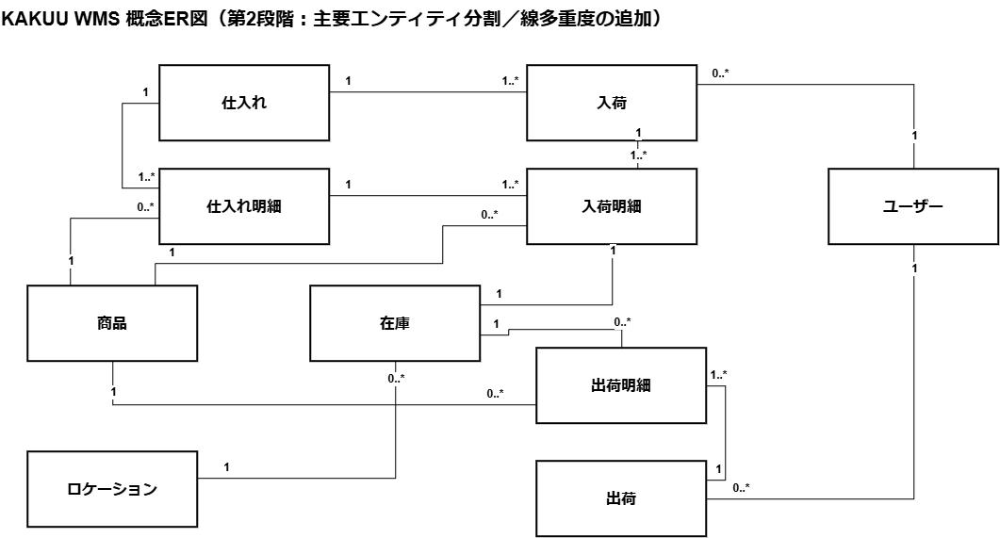
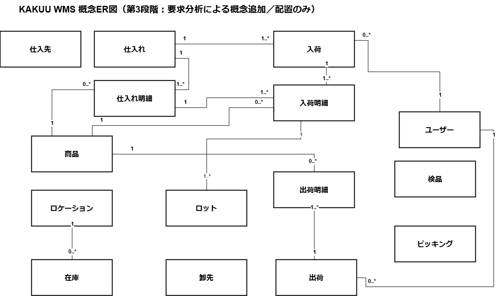
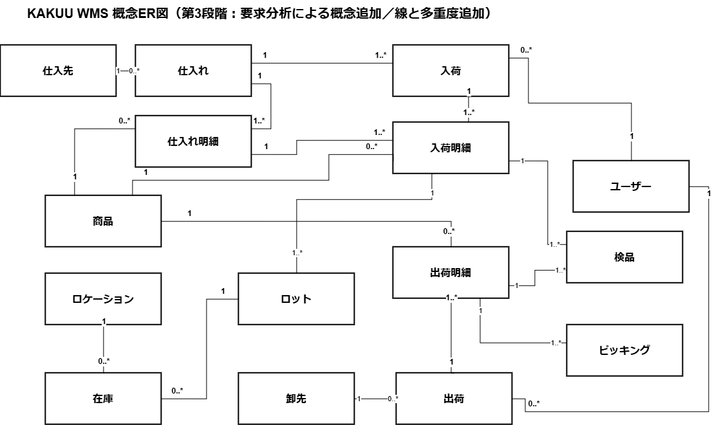

# KAKUU WMS 概念ER図 設計記録

## 第1段階

### 1. 段階・目的

| 項目 | 内容 |
| --- | --- |
| 段階 | 第1段階 |
| 目的 | KAKUU WMSで扱う主要な業務概念と大まかな関係を把握する。詳細なデータ構造への分割は行わず、主要概念を大きな単位で抽出する。 |

### 2. エンティティの考え方

| エンティティ | 扱い | 変更元／関連 | 判断理由 |
| --- | --- | --- | --- |
| 商品 | 新規 | 要求分析 | 仕入れ・入荷・在庫・出荷で共通して扱う商品の基本概念として設定。 |
| 仕入れ | 新規 | 要求分析 | 商品を仕入れる業務を表す概念として設定。 |
| 入荷 | 新規 | 要求分析 | 仕入れた商品を実際に受け入れる業務を表す概念として設定。仕入れとは別業務のため分離。 |
| 在庫 | 新規 | 要求分析 | 入荷によって発生し、保有している商品を表す概念として設定。 |
| 出荷 | 新規 | 要求分析 | 在庫の商品を出荷する業務を表す概念として設定。 |
| ロケーション | 新規 | 要求分析 | 在庫の保管場所を表す概念として設定。 |
| ユーザー | 新規 | 要求分析 | システムを利用して入荷・出荷業務を行う利用者を表す概念として設定。 |

### 3. 配置のみのER図

### 4. 関係・多重度の考え方

| 関係元 | 関係先 | 多重度 | 関係を結ぶ理由 | 多重度の理由 |
| --- | --- | --- | --- | --- |
| 商品 | 仕入れ | 0..* ： 1..* | 商品は仕入れの対象となる。 | 商品は仕入れ実績がなくても存在でき、1回の仕入れでは1つ以上の商品を扱うため。 |
| 仕入れ | 入荷 | 1 ： 0..* | 仕入れた商品を実際に受け入れる業務として入荷と関係付ける。 | 第1段階では未入荷状態も含む大きな業務概念として捉え、1つの仕入れから複数回の入荷が発生し得るため。 |
| 商品 | 在庫 | 1 ： 0..* | 商品と実際に保有する在庫を関係付ける。 | 商品は在庫がない状態でも存在でき、同一商品に複数の在庫が存在し得るため。 |
| ロケーション | 在庫 | 1 ： 0..* | 在庫の保管場所を表すため関係付ける。 | 1つのロケーションに複数在庫を保管でき、空のロケーションも存在できるため。 |
| 在庫 | 出荷 | 1..* ： 0..* | 出荷は在庫を対象として行うため関係付ける。 | 出荷は1つ以上の在庫を対象とし、在庫は未出荷のまま存在でき、複数の出荷に関係し得るため。 |
| 商品 | 出荷 | 0..* ： 1..* | 出荷対象となる商品を表すため関係付ける。 | 商品は出荷実績がなくても存在でき、1回の出荷では1つ以上の商品を扱うため。 |
| 在庫 | 入荷 | 0..* ： 1..* | 在庫は入荷を起点として発生するため関係付ける。 | 入荷は1つ以上の在庫を発生させ、在庫側は第1段階では大分類として複数の入荷との関係を許容して表現するため。 |
| ユーザー | 入荷 | 1 ： 0..* | 入荷業務を行うシステム利用者との関係を表す。 | ユーザーは入荷実績がなくても存在でき、1ユーザーが複数の入荷業務に関係し得るため。 |
| ユーザー | 出荷 | 1 ： 0..* | 出荷業務を行うシステム利用者との関係を表す。 | ユーザーは出荷実績がなくても存在でき、1ユーザーが複数の出荷業務に関係し得るため。 |

### 5. 完成ER図

---

## 第2段階

### 1. 段階・目的

| 項目 | 内容 |
| --- | --- |
| 段階 | 第2段階 |
| 目的 | 第1段階の大分類を基に、KAKUU WMS全体のデータ構造を把握するため、業務上の意味や役割が明確に異なるものを分割する。分割の結果として多対多関係も必要に応じて解消する。 |

### 2. エンティティの考え方

| エンティティ | 扱い | 変更元／関連 | 判断理由 |
| --- | --- | --- | --- |
| 仕入れ明細 | 追加 | 仕入れ | 仕入れの対象商品を明細として分離し、1回の仕入れで複数商品を扱う構造を表現する。 |
| 入荷明細 | 追加 | 入荷 | 入荷の対象商品を明細として分離し、分割入荷を含む入荷内容を表現する。 |
| 出荷明細 | 追加 | 出荷 | 出荷の対象商品を明細として分離し、1回の出荷で複数商品を扱う構造を表現する。 |

### 3. 配置のみのER図

### 4. 関係・多重度の考え方

| 関係元 | 関係先 | 多重度 | 関係を結ぶ理由 | 多重度の理由 |
| --- | --- | --- | --- | --- |
| 商品 | 仕入れ | 削除 | 仕入れ明細を追加したため、商品と仕入れを直接結ぶ関係を削除する。 | 商品―仕入れ明細で商品単位の関係を表現するため。 |
| 商品 | 在庫 | 削除 | 第2段階では入荷明細を起点に在庫を表すため、商品と在庫の直接関係を削除する。 | 商品は入荷明細から把握できるため、直接線を持たせない。 |
| 商品 | 出荷 | 削除 | 出荷明細を追加したため、商品と出荷を直接結ぶ関係を削除する。 | 商品―出荷明細で商品単位の関係を表現するため。 |
| 在庫 | 出荷 | 削除 | 出荷明細を追加したため、在庫と出荷の直接関係を削除する。 | 在庫―出荷明細で出荷対象との関係を表現するため。 |
| 商品 | 仕入れ明細 | 1 ： 0..* | 仕入れ明細がどの商品を対象とするかを表す。 | 商品は仕入れ実績がなくても存在でき、各仕入れ明細は1商品を対象とするため。 |
| 仕入れ | 仕入れ明細 | 1 ： 1..* | 仕入れの内容を商品単位の明細として表す。 | 有効な仕入れには1件以上の明細が必要で、各明細は1つの仕入れに属するため。 |
| 仕入れ | 入荷 | 1 ： 1..* | 仕入れに基づいて入荷が発生することを表す。 | 曜日・日付単位の分割入荷を許容し、現在の想定では未入荷状態を残さないため。 |
| 仕入れ明細 | 入荷明細 | 1 ： 1..* | 仕入れた商品がどの入荷明細として受け入れられたかを表す。 | 1つの仕入れ明細が分割入荷により複数の入荷明細になることがあり、未入荷は許容しないため。 |
| 商品 | 入荷明細 | 1 ： 0..* | 入荷明細が商品マスタ上のどの商品かを表す。 | 商品は入荷実績がなくても存在でき、各入荷明細は必ず1商品を対象とするため。 |
| 入荷 | 入荷明細 | 1 ： 1..* | 入荷の内容を商品単位の明細として表す。 | 有効な入荷には1件以上の明細が必要で、各明細は1つの入荷に属するため。 |
| 入荷明細 | 在庫 | 1 ： 1 | 入荷によって発生する在庫を表す。 | 第2段階ではロット概念をまだ分離していないため、1入荷明細に対して1在庫として扱う。 |
| 商品 | 出荷明細 | 1 ： 0..* | 出荷明細がどの商品を対象とするかを表す。 | 商品は出荷実績がなくても存在でき、各出荷明細は必ず1商品を対象とするため。 |
| 出荷 | 出荷明細 | 1 ： 1..* | 出荷の内容を商品単位の明細として表す。 | 有効な出荷には1件以上の明細が必要で、各明細は1つの出荷に属するため。 |
| 在庫 | 出荷明細 | 1 ： 0..* | 出荷明細が出荷対象とする在庫を表す。 | 在庫は未出荷でも存在でき、同じ在庫が複数回の出荷明細に関係し得るため。 |

### 5. 完成ER図

---

## 第3段階

### 1. 段階・目的

| 項目 | 内容 |
| --- | --- |
| 段階 | 第3段階 |
| 目的 | 第2段階で整理した主要なデータ構造に対し、要求分析でシステム上の管理が必要とされた概念を追加する。対象業務に直接関係するロット・検品・ピッキングに加え、業務上管理が必要な取引先として仕入先・卸先を追加する。 |

### 2. エンティティの考え方

| エンティティ | 扱い | 変更元／関連 | 判断理由 |
| --- | --- | --- | --- |
| ロット | 追加 | 入荷明細・在庫 | 商品をロット単位で管理し、ロット番号・賞味期限・入荷日・在庫数量を管理する要求を反映する。 |
| 検品 | 追加 | 入荷明細・出荷明細 | 入荷・出荷時の検品結果をシステム上の管理対象として扱うため追加する。 |
| ピッキング | 追加 | 出荷明細 | 出荷指示に基づくピッキング対象の情報をシステム上で管理するため追加する。 |
| 仕入先 | 追加 | 仕入れ | 仕入先そのものはシステム内で実施する業務ではないが、仕入れ業務を行ううえで必要な取引先情報として追加する。 |
| 卸先 | 追加 | 出荷 | 卸先そのものはシステム内で実施する業務ではないが、出荷業務を行ううえで必要な取引先情報として追加する。 |

### 3. 配置のみのER図

### 4. 関係・多重度の考え方

| 関係元 | 関係先 | 多重度 | 関係を結ぶ理由 | 多重度の理由 |
| --- | --- | --- | --- | --- |
| 入荷明細 | 在庫 | 削除 | ロットを独立した管理対象として追加したため、入荷明細と在庫の直接関係を削除する。 | 入荷明細―ロット―在庫で関係を表現するため。 |
| 在庫 | 出荷明細 | 削除 | 出荷明細は商品と直接関係し、出荷業務内のピッキング・検品を別概念として追加したため直接関係を削除する。 | 出荷対象の商品は商品―出荷明細で把握できるため、在庫との直接線を持たせない。 |
| 入荷明細 | ロット | 1 ： 1..* | 入荷した商品をロット単位で管理するため関係付ける。 | 1つの入荷明細の商品が複数ロットに分かれることを許容し、各ロットは1つの入荷明細を起点とするため。 |
| ロット | 在庫 | 1 ： 0..* | 在庫をロット単位で管理するため関係付ける。 | 1つのロットを複数のロケーションに分けて保管することを許容するため、複数の在庫に対応できる。また、出荷等によってそのロットの在庫がすべてなくなった状態も想定するため、在庫が存在しない状態を許容する。一方、1つの在庫は必ず1つのロットに対応する。 |
| 出荷明細 | ピッキング | 1 ： 1..* | 出荷明細を基にピッキング対象を管理するため関係付ける。 | 明細化は後段階とし、1つの出荷明細を分割してピッキングすることを許容するため。 |
| 出荷明細 | 検品 | 1 ： 1..* | 出荷対象商品の検品結果を管理するため関係付ける。 | 明細化は後段階とし、1つの出荷明細を分割して検品することを許容するため。 |
| 入荷明細 | 検品 | 1 ： 1..* | 入荷した商品の検品結果を管理するため関係付ける。 | 明細化は後段階とし、1つの入荷明細を分割して検品することを許容するため。 |
| 仕入先 | 仕入れ | 1 ： 0..* | 仕入れ業務で使用する取引先を表すため関係付ける。 | 仕入先は仕入れ実績がなくても登録でき、1つの仕入先に複数の仕入れが発生し得るため。 |
| 卸先 | 出荷 | 1 ： 0..* | 出荷業務で使用する取引先を表すため関係付ける。 | 卸先は出荷実績がなくても登録でき、1つの卸先に複数の出荷が発生し得るため。 |

### 5. 完成ER図

