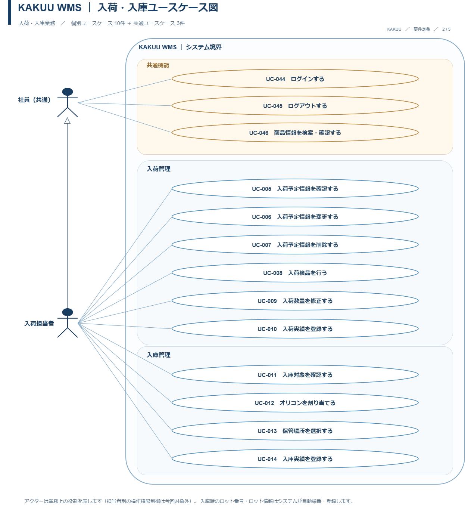
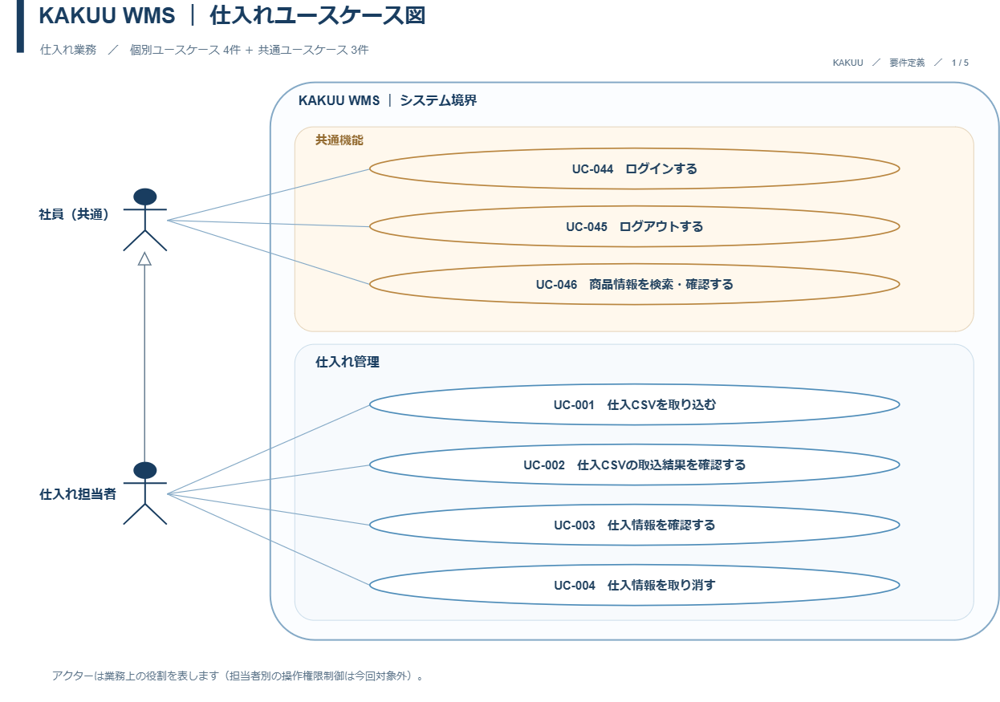
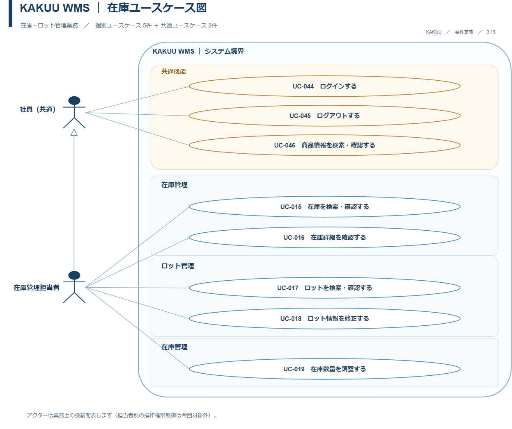
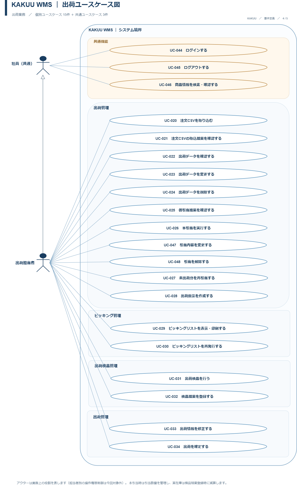
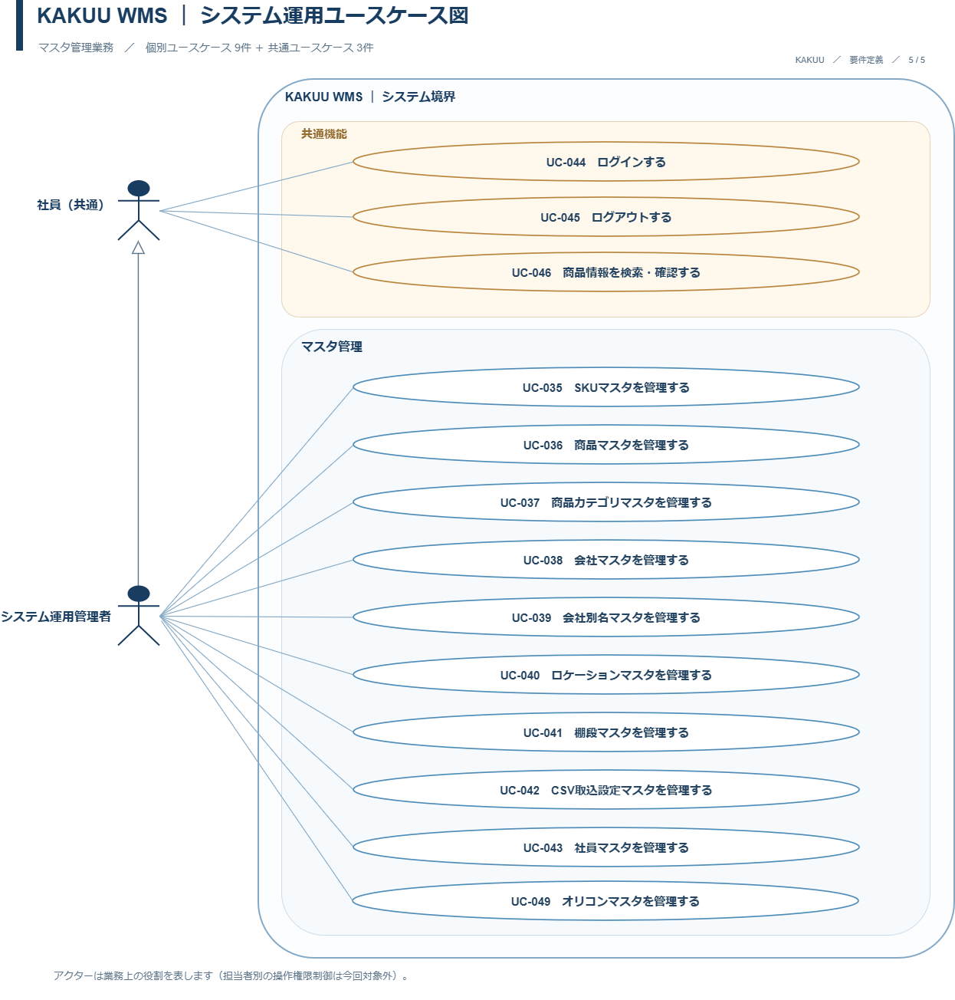

# KAKUU WMS｜ユースケース一覧

要件定義フェーズ  /  有効UC48件 / ID採番 UC-001～UC-050 / アクター6種類＋社員共通

| No. | UC-ID | アクター | ユースケース名 | 概要 | 対応機能 |
| --- | --- | --- | --- | --- | --- |
| 1 | UC-001 | 仕入れ担当者 | 仕入CSVを取り込む | 仕入先から受領したCSVファイルを指定し、仕入情報を登録する。 | 仕入れ管理 |
| 2 | UC-002 | 仕入れ担当者 | 仕入CSVの取込結果を確認する | CSVの取込結果やエラー内容を確認する。 | 仕入れ管理 |
| 3 | UC-003 |  | 仕入情報を確認する |  |  |
| 4 | UC-004 |  | 仕入情報を取り消す |  |  |
| 5 | UC-005 | 仕入れ担当者・入荷担当者 | 入荷予定情報を確認する | 登録済みの入荷予定情報から商品・数量などを確認する。 | 入荷管理 |
| 6 | UC-006 | 仕入れ担当者・入荷担当者 | 入荷予定情報を変更する | 登録済みの入荷予定情報を選択し、内容を変更する。 | 入荷管理 |
| 7 | UC-007 | 仕入れ担当者・入荷担当者 | 入荷予定情報を削除・取消する | 入荷実績が登録されていない入荷予定情報を削除・取消する。 | 入荷管理 |
| 8 | UC-008 | 入荷担当者 | 入荷検品を行う | 納品された商品を確認し、実際の入荷数量を入力する。 | 入荷管理 |
| 9 | UC-009 | 入荷担当者 | 入荷数量を修正する | 検品時に数量の差異があった場合、入荷数量を修正する。 | 入荷管理 |
| 10 | UC-010 | 入荷担当者 | 入荷実績を登録する | 検品で確認した実数を入荷実績として登録する。 | 入荷管理 |
| 11 | UC-011 | 入荷担当者 | 入庫対象を確認する | 入荷実績から入庫対象の商品と入庫待ち数量を確認する。 | 入庫管理 |
| 12 | UC-012 | 入荷担当者 | オリコンを割り当てる | 入庫する商品・ロット・数量をオリコンに割り当てる。 | 入庫管理 |
| 13 | UC-013 | 入荷担当者 | 保管場所を選択する | システム推奨の保管場所を採用するか、作業者が保管場所を指定する。 | 入庫管理 |
| 14 | UC-014 | 入荷担当者 | 入庫実績を登録する | 入庫数量と保管場所を確定し、入庫実績を登録する。 | 入庫管理 |
| 15 | UC-015 | 在庫管理担当者 | 在庫を検索・確認する | 商品・SKUなどを条件に在庫を検索し、数量や保管場所を確認する。 | 在庫管理 |
| 16 | UC-016 | 在庫管理担当者 | 在庫詳細を確認する | 対象在庫のロット・オリコン・保管場所などを確認する。 | 在庫管理 |
| 17 | UC-017 | 在庫管理担当者 | ロットを検索・確認する | ロット番号や賞味期限などから登録済みのロットを検索・確認する。 | ロット管理 |
| 18 | UC-018 | 在庫管理担当者 | ロット情報を修正する | 登録済みのロット情報を修正する。 | ロット管理 |
| 19 | UC-019 | 在庫管理担当者 | 在庫数量を調整する | 破損・紛失などによって発生した在庫数量の差異を調整する。 | 在庫管理 |
| 20 | UC-020 | 注文受付担当者 | 注文CSVを取り込む | 卸先から受領したCSVを指定し、出荷データを登録する。 | 出荷管理 |
| 21 | UC-021 | 注文受付担当者 | 注文CSVの取込結果を確認する | CSVの取込結果やエラー内容を確認する。 | 出荷管理 |
| 22 | UC-022 | 注文受付担当者・出荷担当者 | 出荷データを確認する | 登録済みの出荷データを検索し、注文商品や数量などを確認する。 | 出荷管理 |
| 23 | UC-023 | 注文受付担当者・出荷担当者 | 出荷データを変更する | 登録済みの出荷データを選択し、内容を変更する。 | 出荷管理 |
| 24 | UC-024 | 注文受付担当者・出荷担当者 | 出荷データを削除する | 登録済みの出荷データを選択し、削除する。 | 出荷管理 |
| 25 | UC-025 | 出荷担当者 | 仮引当結果を確認する | 出荷対象の注文を選択して仮引当を行い、引当対象在庫・引当可能数量・不足数量を確認する。 | 出荷管理 |
| 26 | UC-026 | 出荷担当者 | 本引当を実行する | 仮引当結果を確認し、在庫の本引当を実行する。 | 出荷管理 |
| 27 | UC-027 | 出荷担当者 | 未出荷分を再引当する | 在庫補充後、未出荷数量が残っている注文を選択し、再引当する。 | 出荷管理 |
| 28 | UC-028 | 出荷担当者 | 出荷指示を作成する | 引当結果に基づいて出荷指示を作成する。追加出荷指示も含む。 | 出荷管理 |
| 29 | UC-029 | 出荷担当者 | ピッキングリストを表示・印刷する | 作成されたピッキングリストを確認し、作業用に印刷する。 | ピッキング管理 |
| 30 | UC-030 | 出荷担当者 | ピッキングリストを再発行する | 出荷情報の変更などに応じて、リストを再発行する。 | ピッキング管理 |
| 31 | UC-031 | 出荷担当者 | 出荷検品を行う | JANコードを読み取り、商品を確認して検品実数を入力する。 | 出荷検品管理 |
| 32 | UC-032 | 出荷担当者 | 検品結果を登録する | 実際に検品した数量を確定し、登録する。 | 出荷検品管理 |
| 33 | UC-033 | 出荷担当者 | 出荷情報を修正する | 検品実数に合わせるなど、出荷確定前に出荷情報を修正する。 | 出荷管理 |
| 34 | UC-034 | 出荷担当者 | 出荷を確定する | 検品と必要な修正が完了した出荷情報を確定する。 | 出荷管理 |
| 35 | UC-035 | システム運用管理者 | SKUマスタを管理する | SKU情報を登録・変更・参照する。 | マスタ管理 |
| 36 | UC-036 | システム運用管理者 | 商品マスタを管理する | 商品の基本情報を登録・変更・参照する。 | マスタ管理 |
| 37 | UC-037 | システム運用管理者 | 商品カテゴリマスタを管理する | 商品の分類情報を管理する。 | マスタ管理 |
| 38 | UC-038 | システム運用管理者 | 会社マスタを管理する | 仕入先・卸先などの会社情報を管理する。 | マスタ管理 |
| 39 | UC-039 | システム運用管理者 | 会社別名マスタを管理する | CSVで使用される会社の別名や表記揺れを管理する。 | マスタ管理 |
| 40 | UC-040 | システム運用管理者 | ロケーションマスタを管理する | 倉庫内の保管エリア情報を管理する。 | マスタ管理 |
| 41 | UC-041 | システム運用管理者 | 棚段マスタを管理する | ロケーション内の棚・段情報を管理する。 | マスタ管理 |
| 42 | UC-042 | システム運用管理者 | CSV取込設定マスタを管理する | 仕入先・卸先ごとのCSV取込設定を管理する。 | マスタ管理 |
| 43 | UC-043 | システム運用管理者 | 社員マスタを管理する | 社員情報およびログインに必要な情報を管理する。 | マスタ管理 |
| 44 | UC-044 | 社員（共通） | ログインする | 社員マスタに登録されたID・パスワードでログインする。 | 認証管理 |
| 45 | UC-045 | 社員（共通） | ログアウトする | システムからログアウトする。 | 認証管理 |
| 46 | UC-046 | 社員（共通） | 商品情報を検索・確認する | 商品やSKUの基本情報を検索・参照する。 | 商品管理 |
| 47 | UC-047 | 出荷担当者 | 引当内容を変更する | 登録済みの引当内容を選択し、対象在庫や引当数量を変更する。 | 出荷管理 |
| 48 | UC-048 | 出荷担当者 | 引当を解除する | 不要になった引当を選択し、引当状態を解除する。 | 出荷管理 |
| 49 | UC-049 | システム運用管理者 | オリコンマスタを管理する | 倉庫内で使用するオリコンの基本情報を登録・変更・参照する。 | マスタ管理 |
| 50 | UC-050 | 在庫管理担当者 | 在庫を移動する | 対象オリコンを選択し、移動先のロケーション・棚・段を指定して、オリコン単位で保管場所を変更する。 | 在庫管理 |

> UC-003「仕入情報を確認する」はUC-005へ、UC-004「仕入情報を取り消す」はUC-007へ統合した。UC-IDの採番履歴を残すため、旧ユースケース名のみ一覧に残す。

## 入荷担当者

要件定義フェーズ  /  入荷担当者  /  個別ユースケース10件 ＋ 共通ユースケース3件

| No. | UC-ID | アクター | ユースケース名 | 概要 | 対応機能 |
| --- | --- | --- | --- | --- | --- |
| 44 | UC-044 | 社員（共通） | ログインする | 社員マスタに登録されたID・パスワードでログインする。 | 認証管理 |
| 45 | UC-045 | 社員（共通） | ログアウトする | システムからログアウトする。 | 認証管理 |
| 46 | UC-046 | 社員（共通） | 商品情報を検索・確認する | 商品やSKUの基本情報を検索・参照する。 | 商品管理 |
| 5 | UC-005 | 仕入れ担当者・入荷担当者 | 入荷予定情報を確認する | 登録済みの入荷予定情報から商品・数量などを確認する。 | 入荷管理 |
| 6 | UC-006 | 仕入れ担当者・入荷担当者 | 入荷予定情報を変更する | 登録済みの入荷予定情報を選択し、内容を変更する。 | 入荷管理 |
| 7 | UC-007 | 仕入れ担当者・入荷担当者 | 入荷予定情報を削除・取消する | 入荷実績が登録されていない入荷予定情報を削除・取消する。 | 入荷管理 |
| 8 | UC-008 | 入荷担当者 | 入荷検品を行う | 納品された商品を確認し、実際の入荷数量を入力する。 | 入荷管理 |
| 9 | UC-009 | 入荷担当者 | 入荷数量を修正する | 検品時に数量の差異があった場合、入荷数量を修正する。 | 入荷管理 |
| 10 | UC-010 | 入荷担当者 | 入荷実績を登録する | 検品で確認した実数を入荷実績として登録する。 | 入荷管理 |
| 11 | UC-011 | 入荷担当者 | 入庫対象を確認する | 入荷実績から入庫対象の商品と入庫待ち数量を確認する。 | 入庫管理 |
| 12 | UC-012 | 入荷担当者 | オリコンを割り当てる | 入庫する商品・ロット・数量をオリコンに割り当てる。 | 入庫管理 |
| 13 | UC-013 | 入荷担当者 | 保管場所を選択する | システム推奨の保管場所を採用するか、作業者が保管場所を指定する。 | 入庫管理 |
| 14 | UC-014 | 入荷担当者 | 入庫実績を登録する | 入庫数量と保管場所を確定し、入庫実績を登録する。 | 入庫管理 |

## 仕入れ担当者

要件定義フェーズ  /  仕入れ担当者  /  個別ユースケース5件 ＋ 共通ユースケース3件

| No. | UC-ID | アクター | ユースケース名 | 概要 | 対応機能 |
| --- | --- | --- | --- | --- | --- |
| 44 | UC-044 | 社員（共通） | ログインする | 社員マスタに登録されたID・パスワードでログインする。 | 認証管理 |
| 45 | UC-045 | 社員（共通） | ログアウトする | システムからログアウトする。 | 認証管理 |
| 46 | UC-046 | 社員（共通） | 商品情報を検索・確認する | 商品やSKUの基本情報を検索・参照する。 | 商品管理 |
| 1 | UC-001 | 仕入れ担当者 | 仕入CSVを取り込む | 仕入先から受領したCSVファイルを指定し、仕入情報を登録する。 | 仕入れ管理 |
| 2 | UC-002 | 仕入れ担当者 | 仕入CSVの取込結果を確認する | CSVの取込結果やエラー内容を確認する。 | 仕入れ管理 |
| 5 | UC-005 | 仕入れ担当者・入荷担当者 | 入荷予定情報を確認する | 登録済みの入荷予定情報から商品・数量などを確認する。 | 入荷管理 |
| 6 | UC-006 | 仕入れ担当者・入荷担当者 | 入荷予定情報を変更する | 登録済みの入荷予定情報を選択し、内容を変更する。 | 入荷管理 |
| 7 | UC-007 | 仕入れ担当者・入荷担当者 | 入荷予定情報を削除・取消する | 入荷実績が登録されていない入荷予定情報を削除・取消する。 | 入荷管理 |

## 在庫管理担当者

要件定義フェーズ  /  在庫管理担当者  /  個別ユースケース6件 ＋ 共通ユースケース3件

| No. | UC-ID | アクター | ユースケース名 | 概要 | 対応機能 |
| --- | --- | --- | --- | --- | --- |
| 44 | UC-044 | 社員（共通） | ログインする | 社員マスタに登録されたID・パスワードでログインする。 | 認証管理 |
| 45 | UC-045 | 社員（共通） | ログアウトする | システムからログアウトする。 | 認証管理 |
| 46 | UC-046 | 社員（共通） | 商品情報を検索・確認する | 商品やSKUの基本情報を検索・参照する。 | 商品管理 |
| 15 | UC-015 | 在庫管理担当者 | 在庫を検索・確認する | 商品・SKUなどを条件に在庫を検索し、数量や保管場所を確認する。 | 在庫管理 |
| 16 | UC-016 | 在庫管理担当者 | 在庫詳細を確認する | 対象在庫のロット・オリコン・保管場所などを確認する。 | 在庫管理 |
| 17 | UC-017 | 在庫管理担当者 | ロットを検索・確認する | ロット番号や賞味期限などから登録済みのロットを検索・確認する。 | ロット管理 |
| 18 | UC-018 | 在庫管理担当者 | ロット情報を修正する | 登録済みのロット情報を修正する。 | ロット管理 |
| 19 | UC-019 | 在庫管理担当者 | 在庫数量を調整する | 破損・紛失などによって発生した在庫数量の差異を調整する。 | 在庫管理 |
| 50 | UC-050 | 在庫管理担当者 | 在庫を移動する | 対象オリコンを選択し、移動先のロケーション・棚・段を指定して、オリコン単位で保管場所を変更する。 | 在庫管理 |

## 注文受付担当者

要件定義フェーズ  /  注文受付担当者  /  個別ユースケース5件 ＋ 共通ユースケース3件

| No. | UC-ID | アクター | ユースケース名 | 概要 | 対応機能 |
| --- | --- | --- | --- | --- | --- |
| 44 | UC-044 | 社員（共通） | ログインする | 社員マスタに登録されたID・パスワードでログインする。 | 認証管理 |
| 45 | UC-045 | 社員（共通） | ログアウトする | システムからログアウトする。 | 認証管理 |
| 46 | UC-046 | 社員（共通） | 商品情報を検索・確認する | 商品やSKUの基本情報を検索・参照する。 | 商品管理 |
| 20 | UC-020 | 注文受付担当者 | 注文CSVを取り込む | 卸先から受領したCSVを指定し、出荷データを登録する。 | 出荷管理 |
| 21 | UC-021 | 注文受付担当者 | 注文CSVの取込結果を確認する | CSVの取込結果やエラー内容を確認する。 | 出荷管理 |
| 22 | UC-022 | 注文受付担当者・出荷担当者 | 出荷データを確認する | 登録済みの出荷データを検索し、注文商品や数量などを確認する。 | 出荷管理 |
| 23 | UC-023 | 注文受付担当者・出荷担当者 | 出荷データを変更する | 登録済みの出荷データを選択し、内容を変更する。 | 出荷管理 |
| 24 | UC-024 | 注文受付担当者・出荷担当者 | 出荷データを削除する | 登録済みの出荷データを選択し、削除する。 | 出荷管理 |

## 出荷担当者

要件定義フェーズ  /  出荷担当者  /  個別ユースケース15件 ＋ 共通ユースケース3件

| No. | UC-ID | アクター | ユースケース名 | 概要 | 対応機能 |
| --- | --- | --- | --- | --- | --- |
| 44 | UC-044 | 社員（共通） | ログインする | 社員マスタに登録されたID・パスワードでログインする。 | 認証管理 |
| 45 | UC-045 | 社員（共通） | ログアウトする | システムからログアウトする。 | 認証管理 |
| 46 | UC-046 | 社員（共通） | 商品情報を検索・確認する | 商品やSKUの基本情報を検索・参照する。 | 商品管理 |
| 22 | UC-022 | 注文受付担当者・出荷担当者 | 出荷データを確認する | 登録済みの出荷データを検索し、注文商品や数量などを確認する。 | 出荷管理 |
| 23 | UC-023 | 注文受付担当者・出荷担当者 | 出荷データを変更する | 登録済みの出荷データを選択し、内容を変更する。 | 出荷管理 |
| 24 | UC-024 | 注文受付担当者・出荷担当者 | 出荷データを削除する | 登録済みの出荷データを選択し、削除する。 | 出荷管理 |
| 25 | UC-025 | 出荷担当者 | 仮引当結果を確認する | 出荷対象の注文を選択して仮引当を行い、引当対象在庫・引当可能数量・不足数量を確認する。 | 出荷管理 |
| 26 | UC-026 | 出荷担当者 | 本引当を実行する | 仮引当結果を確認し、在庫の本引当を実行する。 | 出荷管理 |
| 27 | UC-027 | 出荷担当者 | 未出荷分を再引当する | 在庫補充後、未出荷数量が残っている注文を選択し、再引当する。 | 出荷管理 |
| 28 | UC-028 | 出荷担当者 | 出荷指示を作成する | 引当結果に基づいて出荷指示を作成する。追加出荷指示も含む。 | 出荷管理 |
| 29 | UC-029 | 出荷担当者 | ピッキングリストを表示・印刷する | 作成されたピッキングリストを確認し、作業用に印刷する。 | ピッキング管理 |
| 30 | UC-030 | 出荷担当者 | ピッキングリストを再発行する | 出荷情報の変更などに応じて、リストを再発行する。 | ピッキング管理 |
| 31 | UC-031 | 出荷担当者 | 出荷検品を行う | JANコードを読み取り、商品を確認して検品実数を入力する。 | 出荷検品管理 |
| 32 | UC-032 | 出荷担当者 | 検品結果を登録する | 実際に検品した数量を確定し、登録する。 | 出荷検品管理 |
| 33 | UC-033 | 出荷担当者 | 出荷情報を修正する | 検品実数に合わせるなど、出荷確定前に出荷情報を修正する。 | 出荷管理 |
| 34 | UC-034 | 出荷担当者 | 出荷を確定する | 検品と必要な修正が完了した出荷情報を確定する。 | 出荷管理 |
| 47 | UC-047 | 出荷担当者 | 引当内容を変更する | 登録済みの引当内容を選択し、対象在庫や引当数量を変更する。 | 出荷管理 |
| 48 | UC-048 | 出荷担当者 | 引当を解除する | 不要になった引当を選択し、引当状態を解除する。 | 出荷管理 |

## システム運用管理者

要件定義フェーズ  /  システム運用管理者  /  個別ユースケース10件 ＋ 共通ユースケース3件

| No. | UC-ID | アクター | ユースケース名 | 概要 | 対応機能 |
| --- | --- | --- | --- | --- | --- |
| 44 | UC-044 | 社員（共通） | ログインする | 社員マスタに登録されたID・パスワードでログインする。 | 認証管理 |
| 45 | UC-045 | 社員（共通） | ログアウトする | システムからログアウトする。 | 認証管理 |
| 46 | UC-046 | 社員（共通） | 商品情報を検索・確認する | 商品やSKUの基本情報を検索・参照する。 | 商品管理 |
| 35 | UC-035 | システム運用管理者 | SKUマスタを管理する | SKU情報を登録・変更・参照する。 | マスタ管理 |
| 36 | UC-036 | システム運用管理者 | 商品マスタを管理する | 商品の基本情報を登録・変更・参照する。 | マスタ管理 |
| 37 | UC-037 | システム運用管理者 | 商品カテゴリマスタを管理する | 商品の分類情報を管理する。 | マスタ管理 |
| 38 | UC-038 | システム運用管理者 | 会社マスタを管理する | 仕入先・卸先などの会社情報を管理する。 | マスタ管理 |
| 39 | UC-039 | システム運用管理者 | 会社別名マスタを管理する | CSVで使用される会社の別名や表記揺れを管理する。 | マスタ管理 |
| 40 | UC-040 | システム運用管理者 | ロケーションマスタを管理する | 倉庫内の保管エリア情報を管理する。 | マスタ管理 |
| 41 | UC-041 | システム運用管理者 | 棚段マスタを管理する | ロケーション内の棚・段情報を管理する。 | マスタ管理 |
| 42 | UC-042 | システム運用管理者 | CSV取込設定マスタを管理する | 仕入先・卸先ごとのCSV取込設定を管理する。 | マスタ管理 |
| 43 | UC-043 | システム運用管理者 | 社員マスタを管理する | 社員情報およびログインに必要な情報を管理する。 | マスタ管理 |
| 49 | UC-049 | システム運用管理者 | オリコンマスタを管理する | 倉庫内で使用するオリコンの基本情報を登録・変更・参照する。 | マスタ管理 |

## アクター・運用方針

ユースケース一覧と連動する件数集計・今回決定した前提条件

| No. | アクター | 関連UC件数 | UC-ID |
| --- | --- | ---: | --- |
| 1 | 仕入れ担当者 | 5 | UC-001、UC-002、UC-005～UC-007 |
| 2 | 入荷担当者 | 10 | UC-005～UC-014 |
| 3 | 在庫管理担当者 | 6 | UC-015～UC-019、UC-050 |
| 4 | 注文受付担当者 | 5 | UC-020～UC-024 |
| 5 | 出荷担当者 | 15 | UC-022～UC-034、UC-047～UC-048 |
| 6 | システム運用管理者 | 10 | UC-035～UC-043、UC-049 |
| 7 | 社員（共通） | 3 | UC-044～UC-046 |

- 複数アクターに紐づくユースケースは、各アクターの関連UC件数に重複して計上する。
- 全体の有効ユースケースは48件とする。UC-003およびUC-004は統合済みのため、有効件数には含めない。

### 確定した前提条件・補足

- 【担当者】アクターは実際の社員単位ではなく業務上の役割を示す。同一社員が複数の役割を兼任することを想定する。今回、担当者ごとの操作権限制御は実装しない。
- 【仕入れ・入荷】UC-003「仕入情報を確認する」はUC-005「入荷予定情報を確認する」へ、UC-004「仕入情報を取り消す」はUC-007「入荷予定情報を削除・取消する」へ統合する。UC-005～UC-007は仕入れ担当者・入荷担当者の双方が行う。
- 【入荷・入庫】入荷担当者は入荷検品と入庫作業を担当。入庫時のロット情報はシステムが自動採番・登録。保管場所はシステム推奨または作業者の手動指定。
- 【注文受付・出荷】UC-020～UC-021は注文受付担当者が担当し、UC-022～UC-024は注文受付担当者・出荷担当者の双方が行う。UC-025以降の引当・出荷指示・ピッキング・出荷検品・出荷確定は出荷担当者が担当する。
- 【出荷・引当】仮引当では出荷対象の注文を選択。引当内容の変更・解除、未出荷分の手動再引当と追加出荷指示作成に対応する。
- 【在庫更新】本引当時には在庫数量を減算せず、引当数量を管理。検品結果登録時に実数に基づいて在庫を減算し、出荷確定時は再減算しない。
- 【今後詳細化】入荷予定情報・出荷データの変更／削除を許可する処理状態など、細かな条件は機能要件で定義する。
