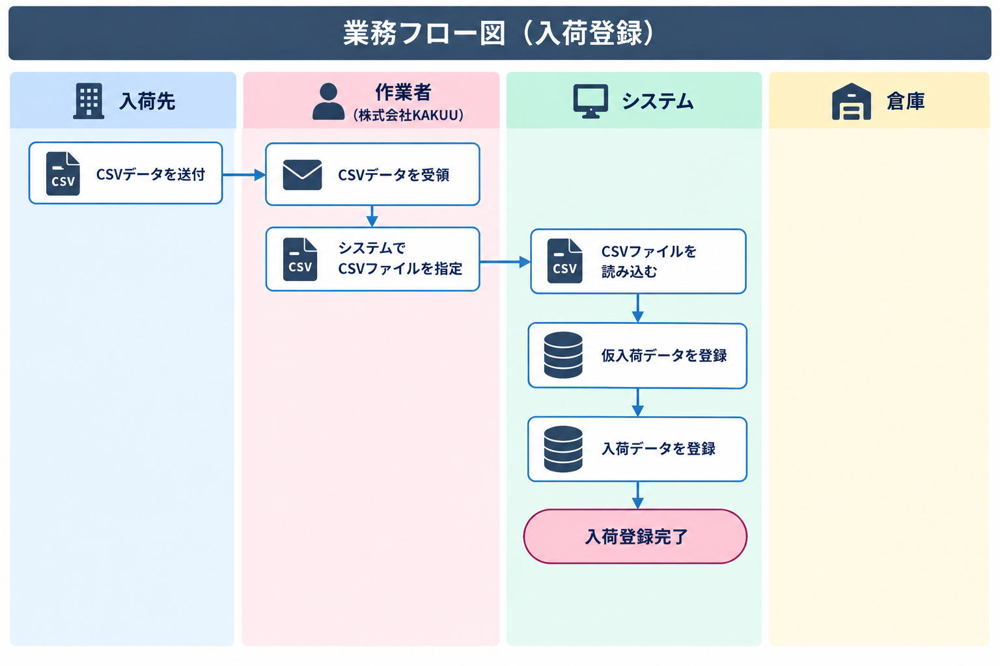
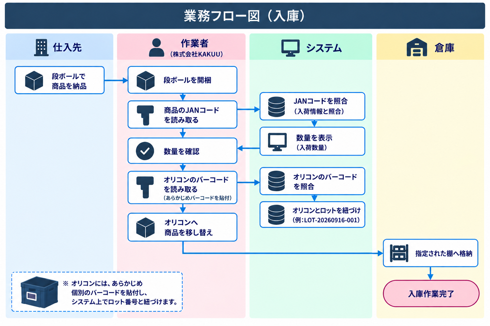
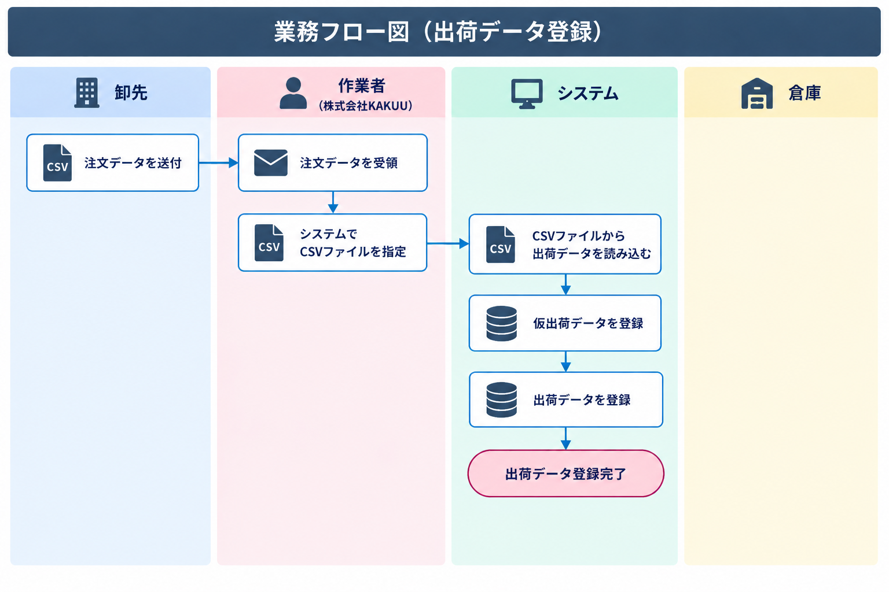
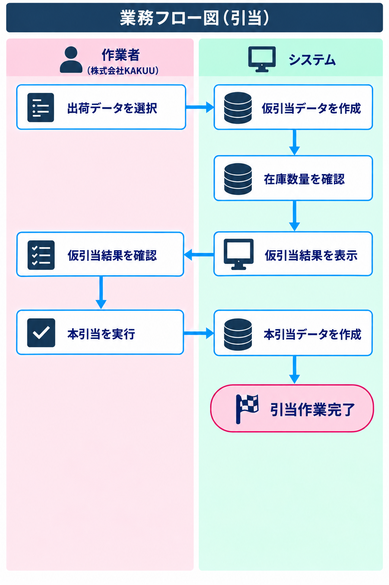
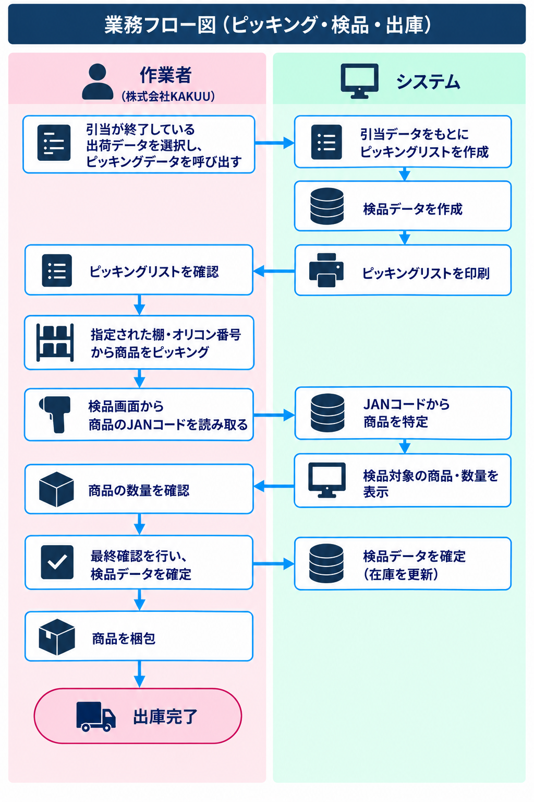
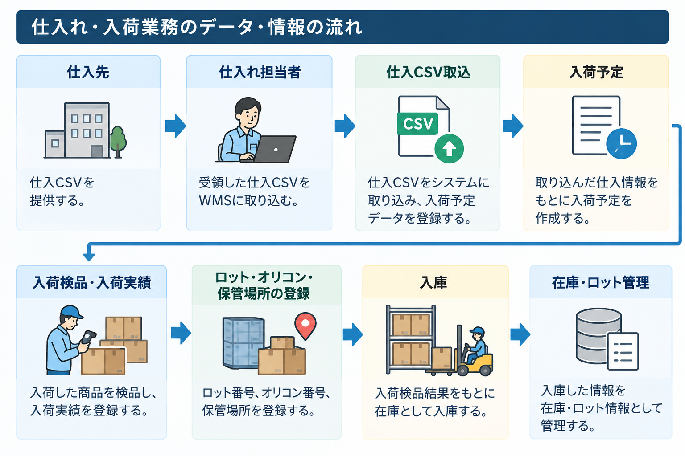
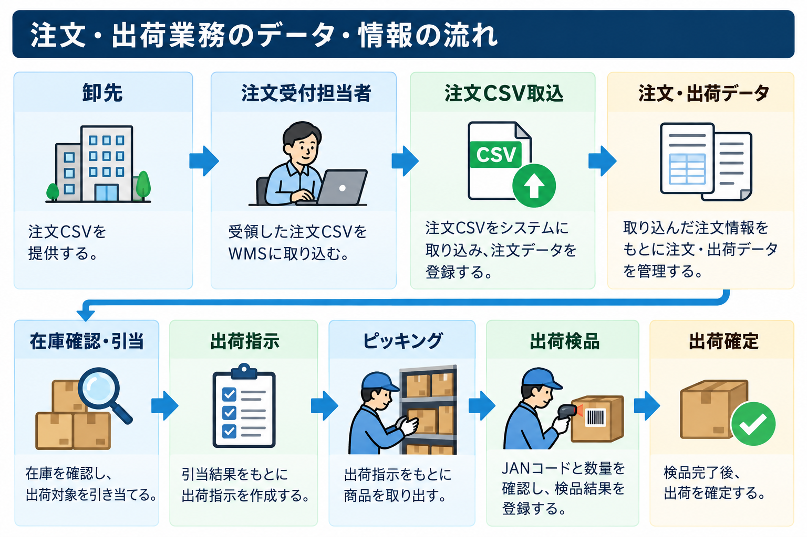

# KAKUU WMS 要件定義

## 目次

1. [はじめに](#1-はじめに)
2. [システム概要](#2-システム概要)
3. [対象業務・対象範囲](#3-対象業務対象範囲)
4. [利用者と役割](#4-利用者と役割)
5. [業務フロー](#5-業務フロー)
6. [機能概要](#6-機能概要)
7. [画面概要](#7-画面概要)
8. [データ・情報の流れ](#8-データ情報の流れ)
9. [非機能要件](#9-非機能要件)
10. [対象外事項](#10-対象外事項)
11. [未確定事項・後続工程への引継ぎ](#11-未確定事項後続工程への引継ぎ)
12. [要件定義の合意事項](#12-要件定義の合意事項)

---

## 1. はじめに

### 1.1 本書の目的

本書は、KAKUU WMSの開発にあたり、システム化する業務の範囲、利用者、必要な機能、画面、データの流れ、および非機能要件を整理し、システムとして実現する内容を明確にすることを目的とする。

本書の内容をもとに、対象とする業務およびシステムの要件について認識を共有し、後続の設計・実装・テストを進めるための基準とする。

### 1.2 本書の位置づけ

本書は、要求分析で整理した業務上の課題や要求をもとに、WMSとして実現する要件を定義したものである。

要件定義後は、本書および関連する詳細資料をもとに、データ設計、外部設計、内部設計、実装、テストを行う。

なお、後続工程で詳細化する内容については、本書では必要な要件および方針までを定義し、具体的な実現方法は各設計工程で決定する。

## 2. システム概要

### 2.1 システムの目的

WMSは、商品の仕入れ、入荷、入庫、在庫、ロット、出荷および検品に関する業務情報を一元的に管理し、倉庫業務を支援するシステムである。

仕入先・卸先から受領したCSV情報をもとに入荷予定や出荷対象を登録し、実際の入荷・入庫・在庫管理・出荷処理までの情報を管理する。

また、在庫については、SKU、ロット、オリコンおよび保管場所を関連付けて管理し、出荷時の引当や在庫移動に利用する。

### 2.2 主な管理対象

WMSでは、主に以下の情報を管理する。

- 商品・SKU
- 取引先会社
- 社員
- 倉庫内のロケーション・棚・段
- オリコン
- 仕入れ・入荷予定
- 入荷・入庫実績
- ロット
- 在庫
- 注文・出荷データ
- 引当情報
- 出荷指示
- 出荷検品結果
- CSV取込結果
- 操作履歴
- エラーログ

### 2.3 システム利用の概要

WMSは、PCから利用するWebシステムとして構築する。

利用者は社員としてログインし、担当する業務に応じて、仕入れ管理、入荷管理、在庫管理、出荷管理、マスタ管理等の各機能を利用する。

倉庫内での商品取り出し等、実際の物理作業については、システムから出力・表示される情報をもとに作業者が実施する。

## 3. 対象業務・対象範囲

### 3.1 対象業務

WMSでは、以下の業務をシステム化の対象とする。

| 業務 | 対象区分 | 概要 |
| --- | --- | --- |
| 商品管理 | 対象 | 商品・SKU等の商品情報を管理する |
| 仕入れ | 一部対象 | 仕入先から受領したCSVの取込から仕入れ情報の登録までを対象とする |
| 入荷 | 対象 | 入荷予定の確認、入荷検品、実際の入荷数量の登録を行う |
| 入庫 | 対象 | 入荷した商品のオリコン割当、保管場所決定、入庫実績登録を行う |
| 在庫管理 | 対象 | 在庫数量、引当済数量、保管場所および在庫移動を管理する |
| ロット管理 | 対象 | ロットおよび期限情報を管理する |
| 出荷 | 対象 | 注文登録、在庫確認、引当、出荷指示、出荷確定までを管理する |
| ピッキング | 一部対象 | ピッキングリストの作成までを対象とする |
| 検品 | 対象 | 出荷対象商品を確認し、検品結果を登録する |
| 出荷履歴管理 | 一部対象 | 出荷確定後のデータを保持する |

### 3.2 一部対象とする業務

仕入れ業務については、仕入先への発注そのものはWMSの対象外とし、仕入先からCSVを受領した後の取込処理から対象とする。

ピッキング業務については、WMSでピッキングリストを作成するところまでを対象とする。倉庫内での商品取り出し作業は、ピッキングリストをもとに作業者が行う。

出荷履歴管理については、出荷確定後の出荷データを保持する。ただし、出荷履歴専用の検索・参照機能は今回の対象外とする。

### 3.3 対象外業務

今回のWMSでは、以下の業務を対象外とする。

| 業務 | 対象外とする内容 |
| --- | --- |
| 仕入れ発注 | 仕入先への発注処理 |
| 出庫 | 倉庫から商品を実際に搬出する作業 |
| 配送管理 | 配送業者との連携および配送状況管理 |
| 請求・領収書 | 請求、領収書作成および送付 |
| 棚卸 | 在庫の棚卸業務 |

これらについては、WMSの今回の実装範囲には含めない。

### 3.4 システム化の範囲

WMSでは、仕入情報の登録から入荷、入庫、在庫管理、出荷指示、検品、出荷確定までの業務情報を一連で管理する。

一方で、仕入先への発注、倉庫外への実際の搬出、配送、請求等のWMS外部で行う業務については、今回のシステム境界外とする。

### 3.5 対象範囲の詳細

本章では、WMSで対象とする業務および対象外とする業務の概要を示す。

各業務・機能の対象区分、システム化の範囲、システム境界および実装対象外とする内容の詳細については、別途作成したスコープ定義資料で定義する。

## 4. 利用者と役割

### 4.1 システム利用者

WMSを利用する社内の利用者を、業務上の役割ごとに以下のとおり整理する。

なお、本書における役割は実際の社員を個別に区分するものではなく、担当する業務を示すものである。同一の社員が複数の役割を兼任する場合がある。

| 役割 | 主な業務 |
| --- | --- |
| 仕入れ担当者 | 仕入CSVの取込、取込結果の確認、入荷予定情報の確認・変更・取消を行う |
| 入荷担当者 | 入荷予定の確認、入荷検品、入荷実績登録、オリコン割当、保管場所指定、入庫実績登録を行う |
| 注文受付担当者 | 注文CSVの取込、取込結果の確認、注文・出荷データの確認・変更・削除を行う |
| 出荷担当者 | 在庫引当、出荷指示、ピッキングリスト発行、出荷検品、出荷確定を行う |
| 在庫管理担当者 | 在庫数量、保管場所、ロット情報の確認、在庫数量調整、在庫移動を行う |
| システム運用管理者 | 社員情報および各種マスタの管理、システム運用に関する対応を行う |

また、今回のWMSでは役割ごとに利用可能な機能を制限する詳細な権限管理は実装対象外とする。

### 4.2 外部関係者

以下の関係者はWMSの業務に関係するが、今回のシステムへ直接ログインして利用する対象とはしない。

| 外部関係者 |データ受渡し・関与内容 |
| --- | --- |
| 仕入先 | 仕入情報をCSVで提供する。担当者が受領したCSVを手動でWMSへ取り込む。仕入先への発注はメールで行い、WMSの対象外とする。 |
| 卸先 | 注文情報をCSVで提供する。担当者が受領したCSVを手動でWMSへ取り込む。卸先がWMSへ直接アクセスすることはない。 |
| 配送業者 | WMSとのシステム間でのデータ受渡しは行わない。出荷確定後の配送手続きはWMSの対象外とし、API連携は将来拡張とする。 |

今回のWMSでは、仕入先および卸先から受領したCSVを担当者が手動で取り込む。

外部関係者がWMSへ直接アクセスする機能や、外部システムとの自動ファイル連携・API連携は実装しない。

将来的には、仕入先・卸先とのファイル共有によるCSV自動取込や、配送業者とのAPI連携を拡張候補とする。

## 5. 業務フロー

### 5.1 業務全体の流れ

WMSでは、仕入れから出荷確定までの業務を以下の流れで管理する。

1. 仕入先から受領した仕入CSVを取り込み、入荷予定を登録する。
2. 商品到着後、入荷予定と実際の商品・数量を確認し、入荷実績を登録する。
3. 商品にロット・オリコン・保管場所を割り当て、入庫する。
4. 入庫した商品を在庫として管理する。
5. 卸先から受領した注文CSVを取り込み、注文情報を登録する。
6. 注文に対して出荷可能な在庫を確認し、在庫を引き当てる。
7. 引当結果をもとに出荷指示とピッキングリストを作成する。
8. 商品をピッキングし、JANコードと数量を確認して検品結果を登録する。
9. 必要な修正が完了した後、出荷を確定する。

### 5.2 在庫不足時の流れ

注文数量に対して在庫が不足している場合は、引当可能な数量のみを出荷対象とする。

不足した数量は未出荷分として保持し、在庫が補充された後に担当者が再度引当を行い、追加出荷する。

### 5.3 在庫管理

入庫後の商品は、在庫数量、ロット、オリコンおよび保管場所を関連付けて管理する。

必要に応じて在庫数量の調整や、オリコン単位での保管場所の変更を行う。

### 5.4 詳細業務フロー

担当者ごとの作業順序や判断条件など、詳細な業務の流れについては、別途作成した業務フロー資料で定義する。

## 6. 機能概要

### 6.1 主な機能

WMSでは、以下の機能を提供する。

| 機能区分 | 主な内容 |
| --- | --- |
| マスタ管理 | 商品、SKU、会社、ロケーション、棚・段、社員、オリコン、CSV取込設定等を管理する |
| 商品参照 | 商品・SKU情報の検索および参照を行う |
| 仕入れ管理 | 仕入CSVの取込、データ検証、入荷予定情報の登録、取込結果確認を行う |
| 入荷・入庫管理 | 入荷予定の確認・変更・取消、入荷検品、入荷実績登録、ロット・オリコン・保管場所の登録を行う |
| 在庫・ロット管理 | 在庫数量、引当済数量、保管場所、ロット情報を管理し、数量調整や在庫移動を行う |
| 出荷管理 | 注文CSV取込、注文情報確認、在庫確認、引当、出荷指示、出荷確定を行う |
| ピッキング | 出荷指示をもとにピッキングリストを作成・表示・印刷する |
| 出荷検品 | JANコードによる商品照合、数量確認、検品結果登録を行う |
| 認証 | 社員によるログイン・ログアウトを行う |

### 6.2 仕入れ・入荷・入庫

仕入先から受領したCSVをWMSへ取り込み、内容を検証したうえで入荷予定情報を登録する。

商品の到着後は、予定情報と実際の商品・数量を確認し、実際の入荷数量を入荷実績として登録する。

その後、ロット、オリコンおよび保管場所を登録し、入庫実績として在庫管理へ引き継ぐ。

### 6.3 在庫・ロット管理

入庫後の商品について、在庫数量、引当済数量、ロット、オリコンおよび保管場所を管理する。

必要に応じて在庫数量の調整や、オリコン単位での保管場所変更を行う。

### 6.4 出荷・検品

卸先から受領した注文CSVを取り込み、注文・出荷データとして登録する。

出荷対象商品の在庫を確認して引当を行い、出荷指示とピッキングリストを作成する。

ピッキング後は、JANコードと数量を確認して検品結果を登録し、必要な修正が完了した後に出荷を確定する。

在庫不足の場合は、引当可能な数量のみを出荷対象とし、不足分を未出荷数量として保持する。  
在庫補充後は、担当者が再引当を行い、追加出荷する。

### 6.5 機能要件の詳細

本章では主要機能の概要を示す。

各機能の利用者、入力情報、処理内容、業務ルール、例外条件等については、別途作成した機能要件資料で定義する。

## 7. 画面概要

### 7.1 画面構成

WMSでは、利用する業務に応じて以下の画面群を用意する。

| 画面区分 | 主な画面 | 主な内容 |
| --- | --- | --- |
| 共通 | ログイン、共通ヘッダー、共通メニュー、各管理メニュー | システムへのログインおよび各業務画面への入口を提供する |
| マスタ管理 | SKU、商品、商品カテゴリ、会社、会社別名、ロケーション、棚・段、CSV取込設定、社員、オリコン | WMSの各業務で使用する基本情報を管理する |
| 商品参照 | 商品情報一覧 | 商品・SKU情報を検索・参照する |
| 仕入れ・入荷 | CSV取込、入荷予定一覧・詳細、入荷検品、オリコン・ロケーション割当 | 仕入CSVの取込から入荷・入庫までの処理を行う |
| 在庫・ロット | 在庫一覧、在庫詳細、ロット一覧、ロット詳細、在庫移動 | 在庫数量、ロット、保管場所等の確認・変更を行う |
| 注文・出荷 | CSV取込、出荷データ一覧・詳細、仮引当、本引当、出荷検品 | 注文CSVの取込から在庫引当、出荷指示、ピッキング、検品、出荷確定までの処理を行う |

要件定義時点では、27画面および6つの共通画面要素を対象として整理する。

### 7.2 画面利用の流れ

利用者はログイン後、共通メニューから担当する業務の管理メニューを選択し、各業務画面へ移動する。

**仕入れ・入荷業務**では、CSV取込画面で仕入情報を登録した後、入荷予定を確認する。商品到着後は入荷検品を行い、オリコンと保管場所を指定して入庫する。

**在庫管理業務**では、在庫一覧から対象商品を検索し、在庫詳細で数量、ロット、オリコン、保管場所を確認する。必要に応じて在庫数量の調整や在庫移動を行う。

**注文・出荷業務**では、CSV取込後に登録された出荷データを確認し、仮引当、本引当を行う。本引当後はピッキングリストを使用して商品を取り出し、出荷検品を行った後に出荷を確定する。

**マスタ管理**では、システム運用管理者が各マスタ管理画面から、WMSで使用する商品、会社、保管場所、社員等の基本情報を管理する。

### 7.3 画面設計の詳細

本章では、WMSで使用する主要な画面構成および画面利用の流れを示す。

各画面の表示項目、入力項目、検索条件、ボタン、画面遷移および共通仕様等の詳細については、別途作成した画面設計資料で定義する。

## 8. データ・情報の流れ

### 8.1 外部とのデータ受渡し

WMSと外部関係者との主なデータ受渡しは以下のとおりとする。

| データ | 受渡し方向 | 受渡し方法 | WMSでの利用 |
| --- | --- | --- | --- |
| 仕入CSV | 仕入先 → 仕入れ担当者 → WMS | 仕入先から受領したCSVを担当者が手動で取り込む | 入荷予定情報として登録する |
| 注文CSV | 卸先 → 注文受付担当者 → WMS | 卸先から受領したCSVを担当者が手動で取り込む | 注文・出荷データとして登録する |

今回の対象では、**WMSから仕入先・卸先へのデータ送信は行わない**。

また、配送業者とのシステム間でのデータ受渡しは行わず、配送に関する手続きはWMSの対象外とする。

外部企業からWMSへの直接アクセス、CSVの自動連携、APIによるシステム間連携についても今回の対象外とする。

### 8.2 WMS内部の情報の流れ

WMSへ取り込まれた情報は、仕入れ・入荷業務および注文・出荷業務の各処理を通じて、後続の業務へ引き継ぐ。

  

   

### 8.3 在庫情報との連携

入庫処理で登録された情報は、在庫・ロット情報として在庫管理へ引き継ぐ。

注文・出荷処理では在庫情報を参照して引当を行い、その結果を出荷指示へ引き継ぐ。

出荷検品結果を登録した際は、検品した数量を在庫情報へ反映する。

また、商品、SKU、会社、ロケーション等のマスタ情報は、仕入れ、入荷、入庫、在庫、注文・出荷等の各業務から参照する。

### 8.4 データフローの詳細

本章では、外部関係者とWMS、およびWMS内部における主要なデータの受渡しと情報の流れを示す。

各処理における詳細なデータの入力元、出力先、保存先については、別途作成したDFDで定義する。

WMSで管理する主要なデータの種類、保持する情報については、論理エンティティ一覧で定義する。

## 9. 非機能要件

### 9.1 基本方針

本システムでは、業務機能の実現に必要な非機能要件を定める。

本ポートフォリオでは、WMSの業務要件、設計、実装、テストの一連の工程を示すことを優先するため、実運用で必要となる一部のインフラ・運用要件については対象外とする。

### 9.2 性能・応答性

画面操作、一覧検索、CSV取込について、通常の業務利用に支障のない応答速度を目標とする。

具体的な応答時間や処理件数等の目標値については、必要に応じて後続の設計工程で検討する。

大規模データを使用した負荷試験や、多数ユーザーによる同時アクセス性能の検証は今回の対象外とする。

### 9.3 セキュリティ

社員ごとのログイン認証を行い、システム利用者を識別する。

パスワードは平文では保持しない方式とする。

担当者や管理者等の役割に応じた詳細な権限制御は、今回の対象外とする。

本番運用を想定したHTTPS環境の構築や、専門的な脆弱性診断についても対象外とする。

### 9.4 ログ・運用

システムの動作確認に必要なアプリケーションログおよび、処理失敗時の原因確認に必要なエラーログを出力する。

重要な操作については、操作した社員、操作日時、操作内容等を操作履歴として記録する。

記録対象とする具体的な操作については、後続の設計工程で定義する。

主要なマスタ情報はWMS上から管理できるものとし、障害発生時にはログ等を利用して原因を確認できる構成を目指す。

本番監視基盤、自動アラート通知、長期間のログ保管は今回の対象外とする。

### 9.5 利用環境・データ保全

PCから利用するWebシステムとして構築し、開発・検証で使用する主要なブラウザを対象とする。

スマートフォン・タブレット専用画面およびハンディターミナルとの連携は対象外とする。

在庫、入荷、出荷等の業務データについては整合性を維持し、データベースでは主キー、外部キー、一意制約等を適切に設定する。

### 9.6 非機能要件の詳細

本章では、WMSにおける主要な非機能要件および基本方針を示す。

性能・応答性、セキュリティ、ログ・運用、利用環境、データ保全等の詳細な要件については、別途作成した非機能要件資料で定義する。

## 10. 対象外事項

本システムでは、今回のポートフォリオで実装・管理しない業務、機能および非機能要件を以下のとおり対象外とする。

### 10.1 業務・機能の対象外

| 区分 | 対象外事項 | 内容 |
| --- | --- | --- |
| 仕入れ | 仕入れ発注 | 仕入先への発注業務はWMSの対象外とする |
| 出庫 | 実際の搬出作業 | 倉庫から商品を搬出する実作業はシステム管理対象外とする |
| 配送 | 配送管理 | 配送業者への配送依頼、配送状況管理等は対象外とする |
| 請求 | 請求・領収書 | 請求処理、領収書作成・送付は対象外とする |
| 棚卸 | 棚卸業務 | 実在庫を確認する棚卸機能は対象外とする |
| 出荷履歴 | 専用の履歴検索・参照機能 | 出荷確定後のデータは保持するが、専用の履歴検索・参照機能は対象外とする |
| ピッキング | ピッキング実績登録 | ピッキングリストの作成までを対象とし、実際の商品取り出しおよび実績登録は対象外とする |
| 外部連携 | CSV自動取込 | 仕入先・卸先との共有ファイルを利用した自動取込は対象外とする |
| 外部連携 | 配送業者API連携 | 配送業者とのAPIによるシステム間連携は対象外とする |
| 権限管理 | 詳細な権限制御 | 利用者の役割に応じた詳細な権限管理、権限マスタは対象外とする |

### 10.2 非機能要件の対象外

以下の非機能要件については、今回のポートフォリオでは対象外とする。

- 高可用性構成
- サーバーおよびデータベースの冗長化
- 自動バックアップ
- 災害復旧環境
- 大規模負荷試験
- 多数ユーザーによる同時アクセス試験
- 本番監視基盤
- メール・チャット等による自動アラート通知
- 専門的な脆弱性診断
- 本番運用を想定したHTTPS・TLS環境の構築
- スマートフォン・タブレット専用UI
- ハンディターミナル連携
- 長期データ・ログアーカイブ
- 自動スケーリング
- 本番運用を想定したインフラ構築

### 10.3 将来拡張

今回対象外とした機能の一部については、将来の機能拡張候補として扱う。

主な候補は以下のとおりとする。

- ファイル共有によるCSV自動取込
- 配送業者API連携
- 棚卸機能
- オリコン内在庫の一部数量移動
- 詳細な権限制御

## 11. 未確定事項・後続工程への引継ぎ

### 11.1 基本方針

本要件定義では、WMSで実現する業務範囲、主要な機能、利用者、画面、データの流れおよび非機能要件の基本方針を定める。

実際の画面構成やデータの持ち方、内部の処理方法などの詳細については、後続の設計工程で決定する。

### 11.2 後続工程で決定する主な事項

| 項目 | 後続工程で決定する内容 |
| --- | --- |
| データ | データの保存方法、項目、関連付け等の詳細 |
| 画面 | 画面レイアウト、表示項目、入力方法、ボタン配置等の詳細 |
| 検索 | 検索条件や検索方法、一覧表示方法等の詳細 |
| 処理 | 各機能の具体的な処理手順やデータ更新方法 |
| エラー対応 | 入力誤りや処理失敗時の表示・対応方法 |
| ログ・履歴 | ログや操作履歴の記録方法 |
| 性能 | 応答時間やCSV取込性能等の具体的な目標 |

## 12. 要件定義の合意事項

### 12.1 合意対象

本要件定義書に記載した以下の内容を、WMSにおける要件定義時点の合意事項とする。

- システムの目的および概要
- 対象業務・対象範囲
- 利用者と役割
- 業務フロー
- 主要な機能
- 画面構成
- データ・情報の流れ
- 非機能要件
- 対象外事項
- 後続工程で詳細化する事項

### 12.2 後続工程への移行

本要件定義の内容をもとに、データ設計、外部設計、内部設計、実装、テストを進める。

要件定義で定めた業務範囲や機能の基本方針を前提とし、画面レイアウト、データ構造、処理方法等の詳細については後続の設計工程で具体化する。

### 12.3 確認

本要件定義書の内容について、対象範囲、主要機能および対象外事項を確認し、要件定義時点の内容として合意する。

| 項目 | 記入欄 |
| --- | --- |
| 確認日 |  |
| 顧客側確認者 |  |
| 作成者 |  |